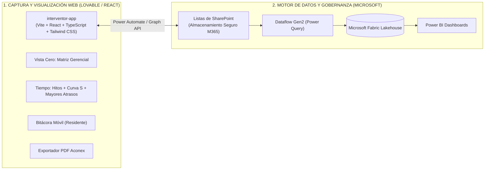

# Contexto, Arquitectura y Estado de Avance: Plataforma Control de Proyectos (Interventor App)

> **Documento de Traspaso para Agente AI y Equipo de Desarrollo**  
> **Fecha de consolidación:** 6 de Noviembre de 2026  
> **Proyecto:** Plataforma Web Integral de Control de Proyectos e Interventoría (Marval S.A.S.)  
> **Repositorio / Carpeta destino:** `interventor-app`  
> **ID Carpeta Google Drive:** `1UOD9PKHFzUyIIEygG55DTRjnsCKQP4gA`  
> **URL Google Drive:** https://drive.google.com/drive/folders/1UOD9PKHFzUyIIEygG55DTRjnsCKQP4gA

---

## 1. Contexto Organizacional y Stakeholders

### A. La Organización y la Escala
* **Empresa:** **Marval S.A.S.** (constructora e inmobiliaria líder en Colombia).
* **Alcance:** Supervisión y control de **más de 100 proyectos activos a nivel nacional**, distribuidos en **5 Sucursales**:
  1. Bucaramanga
  2. Bogotá
  3. Barranquilla
  4. Cartagena
  5. Cali
* **Estructura Interna:** Cada sucursal agrupa proyectos por **Gerencias** (ej. Nathalia Álvarez, Claudia Cruz, Ronald Forero, Pedro Mora, Angie Sierra, Jhair Vargas) y proyectos multi-etapa/torre (ej. *Belaterra Pietra*, *Verdania*, *Country Park Torres 2 y 3*, *Cerros de Santa María*, *La Scala*, *Burdeos*).

### B. Actores Clave y Necesidades
1. **Luis Felipe Lamus Herrera (Líder del Proyecto):**  
   Ingeniero desarrollador de la solución. Ya construyó un tablero exitoso de productividad en Power BI (alimentado vía MS Forms/QR) elogiado internamente como *"pasar de un Renault 4 a un Tesla"*. Lidera la unificación de la plataforma.
2. **Ing. Rubén Darío Ortega (Director de Interventoría):**  
   Define la metodología ejecutiva de control: estandarización de **12 Macro-Hitos** con métrica dual **`I` (Inicio)** y **`E` (Ejecución)**, la **Bitácora Semanal** con **5 Causas Raíz** y el ritmo sano de obra (**4% a 7% mensual**).
3. **Carmen Adriana Santos Bonilla (Coordinadora / Directora Bogotá):**  
   Coordina equipos de interventoría en obra (como Juan Pablo) y seleccionó el proyecto piloto **Verdania en Bogotá** para el despliegue del módulo de productividad.
4. **Dr. Sergio (Alta Gerencia / Vicepresidencia):**  
   Supervisa las 5 sucursales. Necesita una **"Vista Cero / Sábana Gerencial"** en una sola pantalla por sucursal sin ruido visual ni texto operativo excesivo, con semáforos de compuertas de pre-alistamiento a **12 Meses, 6 Meses y 3 Meses** antes de entrega.
5. **Ing. Óscar Tapias (Supervisión Técnica):**  
   Exige **trazabilidad formal auditable** exportable a **Aconex** para contar con respaldo documental histórico cuando la gerencia pregunte las causas de retrasos en frentes de obra.

---

## 2. El Problema a Resolver (Silos y Fragmentación)

Actualmente conviven **"50 modelos de informes distintos"** (desde PDFs densos de 20 páginas con fotos de estuco hasta Excels manuales de consultores externos como MasterPlan) alimentados de **6 fuentes desconectadas**:
* **WorkPlanner:** Cronograma de obra, actividades, fechas planificadas y Curva S.
* **Control:** Gestión contractual (fechas de contratación, actas de inicio, anticipos, modificaciones OW).
* **JD Edwards (JD) / Analytics:** Presupuestos oficiales (`VIV`, `URB`, `ADMINIS`), inventarios y fecha prometida.
* **ARI:** Conteo de ingreso de personal contratista en obra.
* **Aconex (Field / Documents):** Incidencias de supervisión técnica y archivo formal.
* **Forms / QR + Power BI (Luis Felipe):** Medición de productividad en campo.

---

## 3. Decisiones de Arquitectura y Stack Tecnológico (Aprobadas)

El usuario evaluó 3 alternativas y seleccionó formalmente el **Combo 2 (Híbrido Lovable / React + Microsoft 365 Fabric)**:

* **Frontend:** Aplicación web en **React + TypeScript + Vite + Tailwind CSS + Lucide Icons + Recharts**, estructurada para abrir localmente, sincronizar en la nube o importar directamente en **Lovable**.
* **Seguridad Corporativa:** Los datos no residen en servidores de terceros; se sincronizan con las **Listas de SharePoint** y el **Fabric Lakehouse** corporativo de Marval.
* **Punto de Entrada Único:** Tanto en móvil como en escritorio, la app abre siempre en la **Vista Cero de Resumen Gerencial**.

---

## 4. Estructura de Módulos del Sistema (Blueprint Adaptado de PCO)

### Módulo 00: Vista Cero (Matriz Gerencial de Portafolio / Sucursal)
* **Destinatario Principal:** Dr. Sergio, Gerentes de Sucursal y Directores.
* **Estructura:** Agrupación jerárquica: `País` → `Sucursal` (Cali, Bucaramanga, Bogotá, etc.) → `Gerencia` → `Proyecto` → `Torre`.
* **Dos pestañas maestras:** `P-EJECUCIÓN` y `P-ENTREGADOS`.
* **Columnas Clave:**
  1. Fechas: `Línea Base`, `Fecha Prometida` (congelada a <12 meses de entrega), `Fecha Proyectada` y `Días de Atraso/Cumplimiento`.
  2. **Compuertas de Pre-alistamiento (`12M`, `6M`, `3M`):** Días de desvío que tenía la obra a 12, 6 y 3 meses de la entrega para auditar si acelera o empeora.
  3. **Costos (% Presupuesto):** Total proyecto y apertura en Vivienda (`VIV`), Urbanismo (`URB`) y Administrativos (`ADMINIS`).
  4. **Sello de Calidad (%)** y **Productividad Global (%)**.

---

### Módulo 01: Ficha Ejecutiva 1-Página (Respaldo para Aconex)
* **Objetivo:** Generar con 1 clic un informe ejecutivo de una sola página en PDF con diseño limpio estilo "Tesla", listo para radicar formalmente en **Aconex**.
* **Contenido:** KPIs de cabecera con *Hero Stat*, gráfico resumido de hitos con desviaciones `I/E`, semáforo de contratos por vencer/anticipos, y firmas de interventoría.

---

### Módulo 02: Tablero "TIEMPO" (Adaptación de "Plazo, Hitos y Avance" de PCO)
* **Línea de Tiempo de Hitos (Timeline Superior):**
  - Muestra los hitos clave de la torre activa (`Inicio`, `Cimentación`, `Estructura`, `Mampostería`, `Pisos`, `Alistamiento`, `Entrega`).
  - Semáforo de estado: Verde (Cumplido), Azul (En plazo), Ámbar (En riesgo), Rojo (Atrasado).
  - Al tocar el hito despliega: **`I` (Desviación de Inicio en días)** y **`E` (Desviación de Ejecución en días)**.
* **Curva S Sincronizada (Gráfico Inferior en el mismo eje temporal de meses):**
  - Curva de Valor Planificado (`PV`) vs Avance Real Ejecutado (`EV`).
  - Proyección de término calculada según el ritmo de avance real de las últimas 4 semanas (comparado con la regla de oro: **4% a 7% mensual**).
* **Tarjeta "Mayores Atrasos" (Top 5 Desvíos):**
  - Identifica las actividades críticas que más retrasan la torre, mostrando: Tarea, Fin Previsto, Fin Proyectado, Días de Atraso (`VarFin`), Responsable OBS y Causa Raíz asignada.

---

### Módulo 03: WBS Explorer e Ingesta Automática de Cronogramas
* **Principio Rector:** **Cero digitación de tareas manuales**. El sistema ingesta directamente archivos exportados de WorkPlanner/Primavera (ej. `Plantilla Programacion Obra Belaterra.csv`).
* **Lógica del Parser (`wbsParser.ts`):**
  - Detecta la jerarquía EDT: Nivel 2 (Obra) → Nivel 3 (Etapa) → Nivel 4 (Frentes) → Nivel 5 (Torres) → Nivel 6 (Capítulos de Obra).
  - Filtra tareas con `Hito == "Sí"` (`Inicio de obra`, `Inicio de torre`, `Alistamiento`, `Entrega`) y Capítulos Resumen de Nivel 6 (`CIMENTACION`, `ESTRUCTURA`, `MAMPOSTERIA`, `PISOS`, `ENCHAPES`, `PINTURA`, etc.).
  - Mapea estas tareas automáticamente a los **12 Macro-Hitos Estándar de Marval**.
  - Extrae fechas: `ComienPrev`, `FinPrev`, `Comien`, `Fin`, `VarComien`, `VarFin` y `Responsable` de la OBS.

---

### Módulo 04: Bitácora Semanal del Residente y Mapa de 5 Causas
* **Experiencia Móvil (3 minutos en celular):** El residente selecciona su torre y para lo que debía ocurrir esa semana responde:
  1. *¿Cumplió? Sí / No*
  2. *Si no cumplió: ¿Por qué causa?* (Selector de 5 causas estándar)
  3. *¿Cuántos días impacta?*
* **Las 5 Causas Raíz Internas de Marval:**
  1. `Contratos` (atraso en legalización frente a fecha prevista en Control).
  2. `Contratistas / Personal` (déficit de personal en obra).
  3. `Formaleta` (demoras de entrega o penalidades).
  4. `Equipos` (fallas de torre grúa, piloteadoras, etc.).
  5. `Materiales / Compras` (solicitud vs entrada en almacén JD).
  *(Más causas externas: Clima/Lluvias, Suelos/Geotecnia, Diseños, Licencias).*
* **Pareto CNC:** Gráfico analítico mensual (`Ene..Dic`) que totaliza los días de impacto atribuibles a cada causa.

---

### Módulo 05: Lookahead Preventivo de Restricciones (7 Compuertas)
* **Objetivo:** Mirar hacia adelante (ventana de 4 semanas) para desbloquear frentes antes de que ocurra el atraso.
* **Matriz de 7 Compuertas:** Evalúa para cada hito próximo:
  1. `Diseño`
  2. `Contratación`
  3. `Predecesora`
  4. `Materiales`
  5. `Mano de Obra`
  6. `Equipos`
  7. `SST / Ambiental`
* **Cálculo del IP:** Genera automáticamente el **Índice de Preparación (`IP %`)** semaforizado (Verde > 85%, Ámbar 70-85%, Rojo < 70%).

---

### Módulo 06: Productividad "Tesla" y Elevación Vertical
* **4 Actividades Pareto:** `Estructura`, `Mampostería`, `Pañete/Morteros`, `Enchapes/Estuco`.
* **Índice de Personal (%):** `Personal Real en Obra (reportado en ARI) / Personal Esperado según tipología de torre`.
* **Matriz de Cuadrantes (Scatter Plot de Luis Felipe):** Eje X = `% Productividad`, Eje Y = `Unidades/Aptos planeados`, semaforizado por bandas (<75% crítico, 75-90% alerta, >90% meta).
* **Visor de Elevación Vertical:** Reemplaza la sectorización vial 2D de PCO por una matriz visual piso por piso (`Piso 1` a `Piso 12`) de la torre, coloreando el avance de cada actividad crítica.

---

## 5. Inventario de Archivos en la Carpeta de Google Drive

Todos estos archivos ya están subidos y disponibles en la carpeta remota:  
🔗 **[Abrir Carpeta en Google Drive](https://drive.google.com/drive/folders/1UOD9PKHFzUyIIEygG55DTRjnsCKQP4gA)**

1. **`pco-arquitectura-ui-ux-blueprint.md`**  
   Blueprint técnico completo con especificación funcional, modelos de datos, fórmulas matemáticas de EVM/SVM y detalle de visualizaciones PCO.
2. **`Plantilla Informe Gerencial 1.xlsx`**  
   Plantilla oficial de Marval con la estructura de la Matriz Gerencial (`P-EJECUCION`, `P-ENTREGADOS`), fichas de tiempo y costos.
3. **`Plantilla Programacion Obra Belaterra.csv`**  
   Cronograma real WBS exportado de Belaterra Pietra (Torres 1 a 6, Urbanismo, Alistamiento y Entregas con responsables y varianzas).
4. **Subcarpeta `skills/` (Completamente Descomprimida):**  
   Contiene las 18 skills esenciales listas para ser leídas por Antigravity en cualquier máquina:
   * `interview-me/` (guía de entrevistas interactivas uno a uno)
   * `spec-driven-development/` (especificación antes de código)
   * `writing-skills/` (creación de skills modulares)
   * `using-agent-skills/` y `using-superpowers/` (gestión del ecosistema de skills)
   * `frontend-ui-engineering/` (diseño de interfaces de alta gama)
   * `code-review-and-quality/` y `systematic-debugging/`
   * `planning-and-task-breakdown/` y `incremental-implementation/`
   * `verification-before-completion/` y `web-design-guidelines/`
   * `project-analyzer/`, `prototype/`, `emil-design-eng/`, `antislop-code/`, `antislop-ui/`, `mobile-native/`

---

## 6. Hoja de Ruta Inmediata para Construir `interventor-app`

Cuando el agente en el nuevo entorno lea este archivo, los pasos de ejecución son:

1. **Scaffolding del Proyecto Web (`interventor-app`):**
   * Configurar `package.json`, `tsconfig.json`, `vite.config.ts` y `tailwind.config.js`.
   * Dependencias principales: `react`, `react-dom`, `lucide-react`, `recharts`, `clsx`, `tailwind-merge`.
2. **Servicio Parser WBS (`src/services/wbsParser.ts`):**
   * Implementar la función `parseScheduleCsv(csvContent)` que procesa `Plantilla Programacion Obra Belaterra.csv` y extrae la jerarquía de hitos, fechas y responsables.
3. **Modelos y Estado Global (`src/types/` y `src/store/`):**
   * Definir interfaces: `Project`, `Tower`, `Milestone`, `WbsActivity`, `WeeklyLog`, `Constraint`, `PortfolioRow`.
   * Configurar selectores de contexto: `Sucursal`, `Proyecto`, `Torre` y `Fecha de Corte`.
4. **Componentes y Vistas:**
   * `src/components/views/ResumenView.tsx`: Renderizar la Matriz Gerencial para Dr. Sergio (Vista Cero).
   * `src/components/views/TiempoView.tsx`: Timeline interactivo de 12 hitos + Curva S superpuesta + tarjeta Mayores Atrasos.
   * `src/components/views/WbsView.tsx`: Árbol jerárquico EDT filtrable por Responsable OBS.
   * `src/components/views/BitacoraView.tsx`: Checklist móvil de captura semanal + gráfico Pareto de causas.
   * `src/components/views/ProductividadView.tsx`: Gráfico de dispersión (Cuadrantes Tesla) + Proyección a 4 semanas.
   * `src/components/views/LookaheadView.tsx`: Matriz preventiva de 7 compuertas con semáforo `IP %`.
   * `src/components/views/ElevacionView.tsx`: Matriz vertical de la torre piso por piso.
   * `src/components/views/ReportePdfView.tsx`: Plantilla imprimible de 1 página para Aconex.
5. **Conexión a GitHub:**
   * Una vez inicializado el código en la carpeta local, vincularlo al repositorio remoto `interventor-app` mediante `git remote add origin <URL>` y realizar el primer push.
