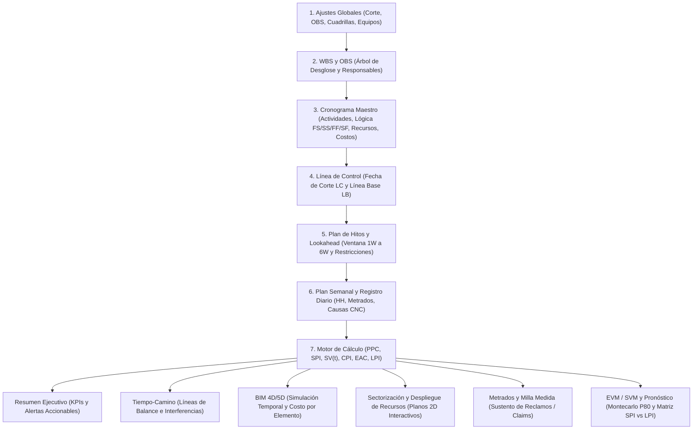
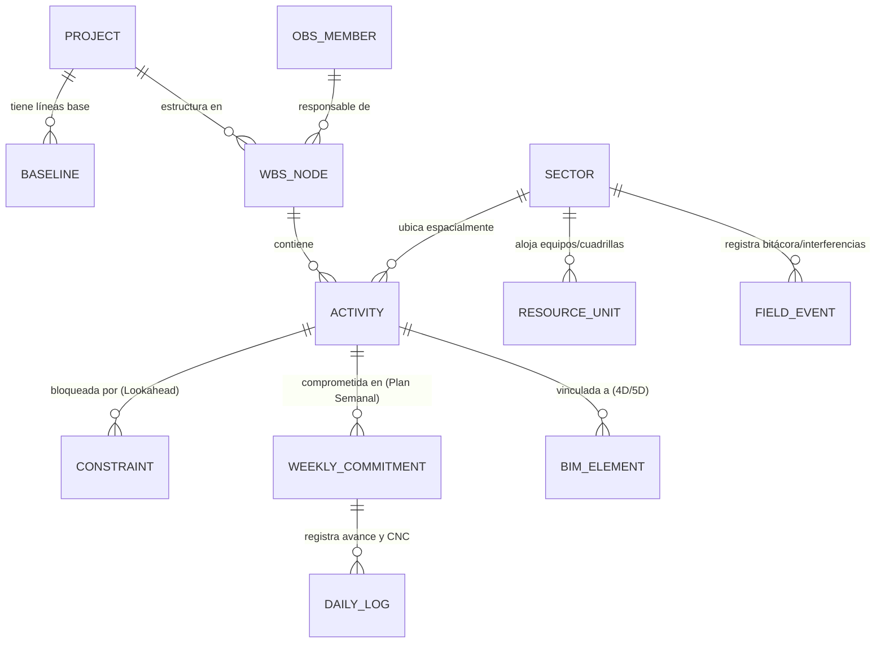
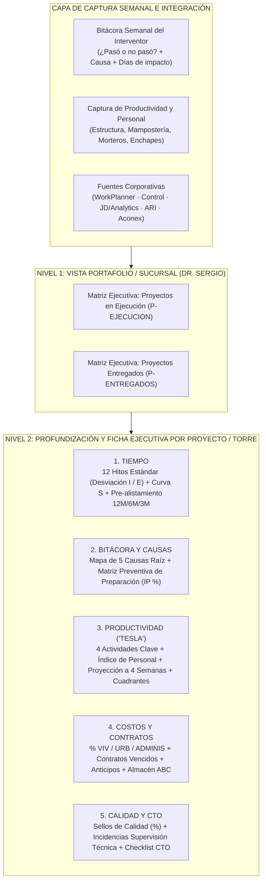
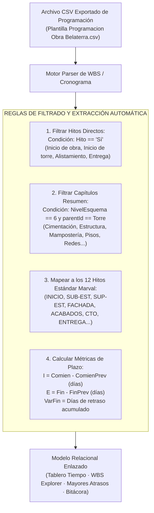

# Análisis de Arquitectura y Diseño UI/UX: Plataforma PCO (Planificación y Control de Obras)

> [!NOTE]
> Este documento desglosa la arquitectura funcional, el modelo de datos reactivo, el sistema de diseño UI/UX y el catálogo de módulos observados en **PCO (Proyecta XR / C.A.T.S.)**. Está diseñado como **documento base (Blueprint)** para construir tu propia **Skill de diseño y desarrollo** adaptada a los módulos que decidas mantener, eliminar o agregar.

---

## 1. Visión Arquitectónica y Flujo de Datos

### 1.1 Principio Rector: Motor Reactivo Basado en Fecha de Corte
A diferencia de las herramientas tradicionales donde el cronograma, el control semanal (Last Planner), los metrados y el Valor Ganado (EVM) viven en archivos desconectados, la arquitectura de PCO opera sobre un **Estado Único Compartido (*Single Source of Truth*)** gobernado por tres parámetros globales:

1. **Fecha de corte (`cutoffDate`):** Punto temporal que divide la historia real ejecutada del pronóstico futuro. Al cambiarla, todos los módulos recalculan instantáneamente avances, atrasos, curvas S, ubicaciones 4D y proyecciones.
2. **Línea Base de comparación (`baselineId`):** Permite alternar en vivo contra qué plan se miden las desviaciones (ej. `LB1 · Línea base contractual` vs. `Programa vigente`).
3. **Validador de Coherencia (`coherenceChecks`):** Motor de reglas en tiempo real que audita inconsistencias entre módulos (ej. actividades sin WBS, fechas fuera de rango, costos desalineados) y muestra un contador accionable (`3 por revisar`, `6 por revisar`).

### 1.2 Grafo de Flujo de Información entre Módulos



---

## 2. Modelo de Dominio (Entidades Principales)

Para replicar esta arquitectura sin duplicidad de datos, todas las vistas deben consumir y mutar un modelo relacional o grafo de entidades unificado:



| Entidad | Atributos Clave Observados | Módulos donde impacta |
| :--- | :--- | :--- |
| **`WBSNode`** | `id`, `code` (autocalculable), `name`, `level`, `parentId`, `obsResponsibleId`, `secondaryResponsibleId`, `startDate`, `endDate`, `duration` | WBS, Cronograma, Sectorización, Reportes |
| **`OBSNode`** | `id`, `name`, `role` (Residente, Jefe de frente, Supervisor), `reportsToId`, `colorTag`, `assignedWbsCount` | WBS/OBS, Lookahead, Plan Semanal |
| **`Activity`** | `id`, `wbsId`, `sectorId`, `crewId`, `commodity`, `duration`, `predecessors` (`FS/SS/FF/SF`), `plannedStart`, `plannedEnd`, `actualStart`, `actualEnd`, `budgetCost (BAC)`, `plannedHours (HH)`, `stationStart` (`0+000`), `stationEnd` (`4+500`) | Todos los módulos |
| **`Milestone`** | `id`, `name`, `type` (`Contractual`, `Compromiso`, `Control`), `plannedDate`, `actualDate`, `status` (`Cumplido`, `En plazo`, `En riesgo`, `Atrasado`) | Resumen, Plan de Hitos, Tiempo-Camino |
| **`Constraint`** | `id`, `activityId`, `type` (`Materiales`, `Equipos`, `Ingeniería`, `Permisos`, `Condiciones previas`), `ownerId`, `dueDate`, `status` (`Abierta`, `Liberada`) | Resumen, Lookahead, Pull Planning |
| **`WeeklyPlan` & `CNC`** | `weekIso`, `activityId`, `plannedDailyQty[L..D]`, `actualDailyQty[L..D]`, `cncCategory`, `cncRootCause` | Plan Semanal, PPC y CNC, Productividad |
| **`SectorPolygon`** | `id`, `name`, `vertices[]`, `status` (`Completado`, `En ejecución`, `Crítico`, `Observado`), `volume`, `plannedHH`, `actualHH` | Sectorización, Recursos, Tiempo-Camino |
| **`ResourceUnit`** | `id`, `code` (`EX-01`, `CU-M-1`), `type` (`Excavadora`, `Grúa`, `Cuadrilla`), `state` (`Operativo`, `Stand-by`, `En taller`), `positionXY`, `sectorId` | Despliegue de Recursos, Productividad |
| **`ClaimEvent`** | `id`, `title`, `type` (`Física`, `Tiempo`, `Lluvias`, `Arqueología`), `sectorId`, `stationRange`, `dateRange`, `photos[]` | Tiempo-Camino, Sectorización, Milla Medida |

---

## 3. Sistema de Diseño UI/UX (Design System)

### 3.1 Estructura del Layout (App Shell de 3 Niveles)

```text
+---------------------------------------------------------------------------------------------------+
| [Logo] PCO. Planificación y Control  | Proyecto [v] | [Buscar indicador/fase...] [Tema] [Guardar] | <- Nivel 1: Top Header
+---------------------------------------------------------------------------------------------------+
| Resumen | WBS | Last Planner | BIM 4D/5D | Tiempo-camino | Sectorización | Recursos | Metrados... | <- Nivel 2: Navegación Módulos
+---------------------------------------------------------------------------------------------------+
| Fecha de corte: [16-10-2026] | Comparar contra: [LB1 Contractual v] | Coherencia: [3 por revisar] | <- Nivel 3: Barra de Contexto
+---------------------------------------------------------------------------------------------------+
| [Sub-navegación opcional: Cronograma maestro | Plan de hitos | Pull Planning | Lookahead | ...]   |
+---------------------------------------------------------------------------------------------------+
| [ Tarjeta KPI 1 ]   [ Tarjeta KPI 2 ]   [ Tarjeta KPI 3 ]   [ Tarjeta KPI 4 ]   [ Tarjeta KPI 5 ] | <- Fila de KPIs de Resumen
+---------------------------------------------------------------------------------------------------+
|                                                 |                                                 |
|         Lienzo Principal Interactivo            |          Panel Analítico / Detalle              | <- Área de Trabajo Split/Grid
|   (Gantt / Mapa 2D / Visor 3D / Curva S /       |     (Tablas filtradas, Alertas accionables,     |
|    Pared Pull Planning / Líneas de Balance)     |      Histogramas, Causas CNC, Bitácora)         |
|                                                 |                                                 |
+---------------------------------------------------------------------------------------------------+
                                                                                     [ + Asistente ]  <- Botón Flotante Contextual
```

### 3.2 Paleta de Colores Semántica (Tokens Visuales)
El diseño utiliza una estética **Light Mode de alta legibilidad para ingeniería** (con soporte de modo oscuro), evitando decoración superflua y reservando el color exclusivamente para codificar estados del proyecto:

| Token Semántico | Color Hex Aprox. | Uso en la Interfaz |
| :--- | :--- | :--- |
| **`bg-surface-canvas`** | `#F8FAFC` | Fondo general de la aplicación para separar visualmente las tarjetas blancas. |
| **`bg-surface-card`** | `#FFFFFF` | Contenedores de tablas, gráficos, visores y tarjetas KPI con borde `1px solid #E2E8F0`. |
| **`brand-primary` / `status-planned`** | `#2563EB` (Azul) | Pestaña activa, botones primarios, curva de **Valor Planificado (`PV`)**, actividades en plazo. |
| **`status-success` / `status-earned`** | `#10B981` (Verde) | Hitos cumplidos, sectores completados, curva de **Valor Ganado (`EV`)** en meta, equipos operativos. |
| **`status-warning` / `status-risk`** | `#F59E0B` (Ámbar) | Desviaciones moderadas (`SPI` ~ `0.85–0.95`), elementos *En proceso*, equipos en *Stand-by*, alertas preventivas. |
| **`status-critical` / `status-delay`** | `#EF4444` (Rojo) | Ruta crítica atrasada (`SPI < 0.85`), sectores críticos, restricciones vencidas, equipos en taller, interferencias. |
| **`status-forecast` / `status-control`** | `#8B5CF6` (Violeta) | Proyecciones estadísticas (**Montecarlo P80**), hitos internos de control, cuadrillas especiales. |
| **`text-primary` / `text-muted`** | `#0F172A` / `#64748B` | Jerarquía tipográfica clara entre valores numéricos protagonistas y etiquetas secundarias. |

### 3.3 Tipografía y Micro-componentes de Datos
* **Números Tabulares (`tabular-nums`):** Imprescindible en tablas WBS, fechas, porcentajes, horas-hombre (`HH`) y montos (`S/` o `USD`) para que las columnas mantengan alineación vertical perfecta al cambiar la fecha de corte.
* **Estructura de Tarjeta KPI (*Executive Metric Card*):**
  1. **Header:** Nombre del indicador en mayúsculas pequeñas (`AVANCE`, `PLAZO · SPI(t)`, `COSTO · CPI`, `PPC`, `RESTRICCIONES`).
  2. **Valor Principal (`Hero Stat`):** Número grande (`24.4%`, `0.69`, `0.90`, `42%`, `9`) coloreado dinámicamente según su umbral de salud.
  3. **Barra de progreso dual o Sparkline:** Comparación visual inmediata entre Real y Planificado.
  4. **Footer contextual:** Delta exacto contra la línea base (`Plan 25.3% · -0.9 pt`, `Pronóstico 27-01-2027 · +19 d`, `Real S/ 608,358 · EAC S/ 2,464,732`).

### 3.4 Patrones de UX Destacados (Qué hace que la interfaz se sienta ágil)
1. **De la "Autopsia" a la Acción Directa (*Actionable Alerts*):**
   En la pestaña `Resumen`, el bloque **Decisiones y alertas** no solo lista problemas (ej. *"6 actividades de ruta crítica atrasadas"*, *"3 restricciones vencidas de 9 abiertas"*), sino que incluye a la derecha un botón de salto directo (`Last Planner ->`, `Productividad ->`, `EVM ->`, `Plan semanal ->`) que navega al módulo exacto con el filtro aplicado.
2. **Manipulación Directa sobre el Espacio de Obra (*Spatial UX*):**
   * En **Sectorización**, el usuario dibuja polígonos con clics sobre el plano (`Polígono libre`, `Rectángulo`, `Círculo`) y al seleccionar un sector se filtran automáticamente su Gantt inferior, su tabla de *commodities* y su curva S.
   * En **Despliegue de Recursos**, las máquinas y cuadrillas son fichas (*tokens*) arrastrables desde las bandejas superiores (`Taller`, `Trabajo fuera de zonas`, `Patio de reserva`) hacia los polígonos del plano. Si varias fichas coinciden en un punto, se agrupan en un *cluster* numérico desplegable.
3. **Sincronización Bidireccional 4D/5D:**
   En **BIM 4D/5D**, el usuario puede tanto reproducir el avance con un *scrubber* temporal (`Reproducir`, `1 día/paso`) como seleccionar elementos geométricos en el visor y pintarlos como *En proceso* o *Completado*, propagando ese avance al resto del sistema.
4. **Explicabilidad y Transparencia Matemática:**
   En **EVM** y **Metrados (Milla Medida)**, el usuario puede alternar entre `Gráfico`, `Indicadores`, `Tarjetas` y `Fórmula`, además de contar con una pestaña dedicada de `Teoría` para que ningún indicador sea una "caja negra".

---

## 4. Catálogo Detallado de Módulos (Base para tu Selección)

Utiliza esta tabla como **matriz de decisión** para definir qué módulos conservarás, cuáles modificarás, cuáles eliminarás y cuáles agregarás en tu propia plataforma:

| # | Módulo en PCO | Sub-vistas / Componentes Clave | Propósito Principal | Estado para tu Plataforma |
| :- | :--- | :--- | :--- | :--- |
| **01** | **Resumen (Tablero Ejecutivo)** | • 6 KPIs superiores (`Avance`, `SPI(t)`, `CPI`, `PPC`, `Restricciones`, `BIM 4D/5D`)<br>• Línea de tiempo de hitos + Curva S superpuesta (`PV`, `EV`, `AC`)<br>• Tabla de *Mayores atrasos*<br>• Panel de *Decisiones y alertas* con links de acción<br>• *Frentes e hitos* vs. Línea Base | Visión gerencial en una sola pantalla para detectar desvíos de plazo, costo y confiabilidad semanal. | `[ ] Mantener`<br>`[ ] Modificar`<br>`[ ] Eliminar` |
| **02** | **WBS y OBS** | • Tabla jerárquica editable con recodificación automática (`1`, `4.1`, `4.2`)<br>• Conmutador `Ver como árbol` con buscador en vivo<br>• Árbol visual de **Organigrama de Responsables (OBS)** vinculado a niveles WBS | Estructurar el alcance del proyecto y asignar responsables técnicos claros por frente/paquete de trabajo. | `[ ] Mantener`<br>`[ ] Modificar`<br>`[ ] Eliminar` |
| **03** | **Last Planner** | • **Cronograma maestro:** Lista, Tabla y Gantt con ruta crítica<br>• **Plan de hitos:** Semáforo por tipo (Contractual, Compromiso, Control)<br>• **Pull Planning:** Pizarra colaborativa de *post-its* por grupo/cuadrilla con alerta de enlaces en conflicto<br>• **Lookahead (1W–6W):** Gestión y liberación de restricciones y carga de `HH`<br>• **Plan semanal:** Compromiso diario (`L` a `D`) en `HH` o metrado<br>• **PPC y CNC:** Gráfico semanal/acumulado y Pareto de Causas de No Cumplimiento | Llevar la planificación desde el largo plazo (hitos) hasta el compromiso operativo semanal libre de restricciones. | `[ ] Mantener`<br>`[ ] Modificar`<br>`[ ] Eliminar` |
| **04** | **BIM 4D / 5D** | • Visor multicapa (`Planta`, `Isométrica`, `3D`)<br>• Modos de color (`Real`, `Programado`, `Desviación`, `Lookahead`, `Atributo`)<br>• Reproductor temporal (`1 día/paso`)<br>• Panel inferior con pestañas: `Elemento`, `Actividades`, `Avance 4D`, `Avance 5D` (`BAC`, `PV`, `EV`, `AC`, `TCPI`), `Bitácora`, `Realidad aumentada` | Vincular visualmente los elementos del modelo con el cronograma (4D) y el presupuesto (5D). | `[ ] Mantener`<br>`[ ] Modificar`<br>`[ ] Eliminar` |
| **05** | **Tiempo-Camino (Líneas de Balance)** | • Gráfico espacio-temporal (`X: Progresiva 0+000 a 4+500`, `Y: Tiempo`)<br>• Filtro rápido de actividades y pendientes de rendimiento<br>• Detección visual de cruces de cuadrillas<br>• Dibujo de áreas rayadas de **Interferencias y Claims**<br>• Superposición opcional de Curva S, Gantt, Balance de masas e Histograma HH | Controlar obras lineales o repetitivas (líneas eléctricas, carreteras, ductos, edificios en altura) y sustentar interferencias espaciales. | `[ ] Mantener`<br>`[ ] Modificar`<br>`[ ] Eliminar` |
| **06** | **Sectorización** | • Editor de polígonos sobre plano 2D con estados tipo semáforo<br>• Tabla de avances (`Por sector`, `Por partida`, `Por commodity`)<br>• Gantt filtrado por sector + Histograma y Curva S<br>• **Bitácora de eventos** geolocalizados en plano con exportación a informe fotográfico | Dividir territorialmente la obra para controlar volúmenes, horas-hombre y eventos de campo por zona geográfica. | `[ ] Mantener`<br>`[ ] Modificar`<br>`[ ] Eliminar` |
| **07** | **Despliegue de Recursos** | • KPIs de flota (`Unidades`, `Disponibilidad %`, `Stand-by`, `Inoperativos/Taller`, `Cuadrillas`)<br>• Bandejas de equipos fuera de frente (`Taller`, `Reserva`)<br>• Mapa interactivo *Drag & Drop* con fichas de equipos y cuadrillas<br>• Simulador animado de rutas (`Simular rutas` con control de velocidad) | Visualizar en tiempo real dónde está cada máquina y cuadrilla, detectar equipos parados y optimizar traslados. | `[ ] Mantener`<br>`[ ] Modificar`<br>`[ ] Eliminar` |
| **08** | **Metrados y Milla Medida** | • Registro de metrados por fase/commodity/cuadrilla<br>• **Calculadora de Milla Medida (*Measured Mile*):** Botón `Sugerir` que compara el periodo *Referencia* (sin impacto) vs. *Impactado*<br>• Cálculo automático de `Factor de impacto (%)`, `HH perdidas` y monto valorizado (`S/` y `USD`) | Cuantificar pérdidas de productividad con rigor pericial para sustentar reclamos (*Claims*) de costos y plazos. | `[ ] Mantener`<br>`[ ] Modificar`<br>`[ ] Eliminar` |
| **09** | **Productividad** | • Rendimiento real vs. previsto por partida y cuadrilla<br>• Índice de Productividad Laboral (`LPI`) e histogramas de recursos | Analizar la eficiencia de mano de obra y equipos para distinguir si un atraso es por falta de frente o bajo rendimiento. | `[ ] Mantener`<br>`[ ] Modificar`<br>`[ ] Eliminar` |
| **10** | **EVM · SVM** | • Conmutador entre **SVM (Tiempo Ganado en días)** y **EVM (Valor Ganado en costo/HH)**<br>• Curva S completa (`PV`, `EV`, `AC`, `BAC`, `EAC`, `ETC`)<br>• **Pronóstico de fecha de fin** multi-método (`CPM`, `RAS25`, `Valor Ganado`, `Productividad LPI`, `Montecarlo P80`, `Ajuste logístico`)<br>• **Matriz de Diagnóstico `SPI(t)` vs. `LPI`** (4 cuadrantes: *Adelantado y productivo*, *Adelantado con baja productividad*, *Atrasado pero productivo*, *Atrasado y baja productividad*) | Pronosticar con meses de anticipación cuándo terminará la obra y cuánto costará al cierre (`EAC`). | `[ ] Mantener`<br>`[ ] Modificar`<br>`[ ] Eliminar` |

---

## 5. Estructura Recomendada para tu Futura Skill

Cuando definamos qué módulos quedan, cuáles salen y cuáles se agregan, empaquetaremos todo en una Skill modular dentro de tu espacio de trabajo siguiendo la arquitectura progresiva de Antigravity:

```text
.agents/skills/construction-project-control/
├── SKILL.md                                  # Instrucciones principales, principios de arquitectura, reglas UI/UX y flujo de trabajo
├── references/
│   ├── domain-model-and-formulas.md          # Esquema de base de datos, fórmulas exactas de EVM/SVM, PPC, LPI y Milla Medida
│   ├── ui-ux-design-system.md                # Tokens de color, layout shell de 3 niveles, componentes KPI, tablas densas y lienzos 2D/3D
│   └── modules-specification.md              # Especificación funcional detallada de tus módulos definitivos (Mantenidos + Nuevos)
└── examples/
    └── reactive-cutoff-store.ts              # Ejemplo de referencia del estado reactivo por Fecha de Corte y Línea Base
```

> [!TIP]
> **Ventaja de dividir la Skill en `SKILL.md` + `references/`:**
> Mantener el archivo principal `SKILL.md` enfocado en las reglas de diseño/arquitectura y delegar las fórmulas matemáticas y especificaciones extensas a `references/` permite que el agente cargue bajo demanda solo el contexto que necesita en cada tarea (por ejemplo, al construir el módulo EVM o al diseñar el tablero Last Planner), ahorrando ventana de contexto y aumentando la precisión.

---

## 6. Análisis de Sesiones de Trabajo (Marval / Interventoría) y Alineación con la Arquitectura PCO

Esta sección sintetiza los requerimientos extraídos de las dos sesiones de trabajo con el **Ing. Rubén Darío Ortega** y **Carmen Adriana Santos Bonilla** ([Llamada 2026-10-16](file:///c:/Users/llamus/Documents/nucleo%20de%20agentes/plataforma%20control%20de%20proyectos/Llamada%20con%20Ruben%20Dario%20Ortega-20261016_160431-Grabaci%C3%B3n%20de%20la%20reuni%C3%B3n.mp4) y [Llamada 2026-10-19](file:///c:/Users/llamus/Documents/nucleo%20de%20agentes/plataforma%20control%20de%20proyectos/Llamada%20con%20Ruben%20Dario%20Ortega-20261019_162822-Grabaci%C3%B3n%20de%20la%20reuni%C3%B3n.mp4)), junto con el análisis estructural de la [Plantilla Informe Gerencial 1.xlsx](file:///c:/Users/llamus/Documents/nucleo%20de%20agentes/plataforma%20control%20de%20proyectos/Plantilla%20Informe%20Gerencial%201.xlsx).

### 6.1 Diagnóstico del Problema Actual en la Organización
1. **Fragmentación de Informes ("50 modelos distintos"):** Cada interventor o sucursal presenta informes con formatos dispares (desde PDFs densos de 20 páginas con fotos operativas como en *Cerros de Santa María*, hasta fichas uniproyecto de consultores externos como *MasterPlan / KM* en *La Scala* y *Burdeos*). La Alta Gerencia (**Dr. Sergio**, quien supervisa ~100 proyectos en 5 sucursales: **Bucaramanga, Bogotá, Barranquilla, Cartagena y Cali**) requiere una lectura ejecutiva estandarizada en una sola pantalla por sucursal/gerencia.
2. **Silos de Información ("Muchas herramientas pero nada integral"):**
   - **WorkPlanner:** Programación de obra, actividades, fechas de inicio/fin planeadas y Curva S.
   - **Control:** Gestión contractual (fecha planeada de contratación vs. fecha legalizada, actas de inicio, descuentos, modificaciones OW, amortización de anticipos).
   - **JD Edwards (JD) / Analytics:** Presupuestos oficiales, costos ejecutados (`VIV`, `URB`, `ADMINIS`), compras, inventario de almacén y rotación ABC.
   - **ARI:** Control de ingreso y permanencia de personal contratista en obra.
   - **Aconex (Field / Documents):** Incidencias de supervisión técnica y repositorio formal de comunicaciones/informes (requerimiento clave del **Ing. Óscar Tapias** para trazabilidad histórica ante desvíos).
   - **App QR / MS Forms + Power BI Productividad (desarrollado por Luis Felipe Lamus):** Captura ágil en campo y tablero ejecutivo de productividad (elogiado en la reunión como *"pasar de un Renault 4 a un Tesla"*).

---

### 6.2 Estructura Funcional Requerida (2 Niveles de Navegación + Captura en Campo)



#### A. Nivel 1: Matriz Gerencial de Portafolio / Sucursal (`P-EJECUCION` y `P-ENTREGADOS`)
- **Agrupación jerárquica:** País -> Sucursal (Bucaramanga, Bogotá, etc.) -> Gerencia (ej. Nathalia Álvarez, Claudia Cruz, Ronald Forero, Pedro Mora, Angie Sierra, Jhair Vargas) -> Proyecto -> Torre activa.
- **Columnas de la Matriz Maestra (`P-EJECUCION`):**
  1. **Fechas de Entrega:** `Fecha Línea Base`, `Fecha Prometida / Confirmada por Gerente` (congelada a menos de 12 meses de la entrega), `Fecha Proyectada` y **Días de Cumplimiento / Atraso**.
  2. **Inspecciones de Pre-alistamiento (`12 Meses`, `6 Meses`, `3 Meses` antes de entrega):** Muestra la evolución de los días de atraso en cada compuerta (ej. `78 d` a los 12M -> `45 d` a los 6M -> `15 d` a los 3M) para medir si la obra recupera ritmo o empeora antes de entregar.
  3. **Costos (% Ejecución vs. Presupuesto):** Total proyecto desagregado en **Vivienda (`VIV`)**, **Urbanismo (`URB`)** y **Administrativos (`ADMINIS`)** (foco crítico cuando los plazos se extienden).
  4. **Sello de Calidad (%):** Promedio ponderado de sellos de calidad de las torres en ejecución.
  5. **Productividad (%):** Índice global de rendimiento del proyecto.

#### B. Nivel 2: Pestañas de Profundización y Ficha Ejecutiva (Estilo *MasterPlan* + Estética *Tesla*)
1. **Pestaña `TIEMPO` (Trazabilidad por 12 Hitos Estándar con Métrica Dual `I / E`):**
   - Estandarización de **12 Hitos constructivos de edificación** (`INICIO`, `SOTANOS`, `SUB-EST`, `SUP-EST`, `FACHADA`, `MUR INT`, `ACABADOS`, `INST EQUIP`, `CUBIERTA`, `URB INT`, `CTO`, `SERV PUBLICOS` + `ENTREGA`).
   - Cada hito registra dos indicadores en días:
     - **`I` (Desviación de Inicio):** Días de adelanto (`-`) o atraso (`+`) al iniciar el hito respecto a la línea base.
     - **`E` (Desviación de Ejecución / Proyección):** Días ganados o perdidos *durante* la ejecución del hito (permite leer la historia clínica del proyecto en 10 segundos: ej. inició 20 días antes, pero perdió 230 días en subestructura por micropilotes).
   - **Ritmo de Avance Mensual:** Comparativa `% Programado` vs. `% Ejecutado` y velocidad mensual (regla de control: `4% a 7% mensual` en torres de 15 a 24 meses).
2. **Bitácora Semanal del Interventor y Mapa de Causas de Incumplimiento:**
   - Captura semanal enfocada en las actividades críticas que debían iniciar o avanzar esa semana: **¿Cumplió? Sí/No -> ¿Por qué causa? -> ¿Cuántos días impacta?**
   - **5 Causas Estándar internas** (trazadas mes a mes de Enero a Diciembre y por actividad):
     1. `Contratos` (atraso en legalización frente a fecha prevista en *Control*).
     2. `Contratistas / Personal` (déficit de mano de obra medido con el **Índice de Personal** = `Personal Real / Personal Esperado según tipología`).
     3. `Formaleta` (atrasos de entrega o penalidades por no devolución).
     4. `Equipos` (fallas o retrasos de torre grúa, piloteadora, etc.).
     5. `Materiales / Compras` (solicitud de pedido vs. entrada en almacén `JD`).
     *(Más causas externas: Lluvias/Clima, Suelos/Geotecnia, Diseños, Licencias).*
3. **Matriz Preventiva de Restricciones ("Lo que se viene" / Lookahead Mensual):**
   - Inspirada en la tabla de *Próximas Actividades Críticas* de MasterPlan: evalúa para cada hito próximo 7 compuertas de alistamiento (**Diseño, Contratación, Predecesora, Materiales, Mano de Obra, Equipos, SST**) calculando un **IP (Índice de Preparación %)** semaforizado.
4. **Pestaña `PRODUCTIVIDAD` (Integración del Tablero "Tesla"):**
   - Enfocada en las **4 actividades pareto**: **Estructura, Mampostería, Morteros/Pañete y Enchapes/Estuco** (con apertura de piloto en **Verdania - Bogotá** coordinado con Carmen Adriana Santos y Juan Pablo).
   - Indicadores por torre: `Inicio (días atraso)`, `Tiempo Estimado (meses)`, `Tiempo Proyectado (meses según ritmo de las últimas 4 semanas)`, `% Productividad`, `% Índice de Personal` y `Avance en Pisos/Unidades (Real vs. Programado)`.
   - Incluye la **Matriz de Cuadrantes (Scatter Plot)**: Eje X = `% Productividad`, Eje Y = `Unidades/Aptos planeados`, semaforizado por bandas (`<75%` crítico, `75-90%` alerta, `>90%` óptimo).
5. **Pestañas `COSTO`, `CALIDAD` y `CTO` (Balanced Scorecard de Obra):**
   - **Contratos y Almacén:** Semáforo de contratos por vencer/vencidos, desviación en amortización de anticipos, modificaciones OW y rotación ABC de almacén.
   - **Calidad y Entrega:** Avance de **Sellos de Calidad** por piso/apartamento, estado de **Incidencias de Supervisión Técnica en Aconex** (abiertas vs. cerradas) y checklist documental del **CTO (Certificado Técnico de Ocupación)**.

---

### 6.3 Matriz de Alineación: Arquitectura PCO vs. Plataforma Control de Proyectos Marval

| Módulo PCO Original | Decisión Recomendada | Cómo se Transforma / Alinea para Marval (Interventoría) |
| :--- | :--- | :--- |
| **Nivel 0 (Inexistente en PCO)** | **➕ AGREGAR (Nuevo)** | **Vista Portafolio Nacional / Sucursal (`P-EJECUCION` y `P-ENTREGADOS`):** Matriz ejecutiva multiproyecto para el Dr. Sergio con filtro por Sucursal y Gerencia, inspecciones `12M/6M/3M`, costos `VIV/URB/ADMINIS`, Sello de Calidad y Productividad. |
| **01. Resumen Ejecutivo** | **🔄 ADAPTAR** | **Ficha Ejecutiva Unificada por Proyecto/Torre (1 Página):** Combina KPIs macro, matriz de los 12 Hitos con desviación `I/E`, Curva S, alertas contractuales/almacén y tabla preventiva de próximas actividades críticas (`IP %`), con exportación limpia a PDF para colgar en **Aconex**. |
| **02. Cronograma / Gantt** | **🔄 SIMPLIFICAR** | **Tablero `TIEMPO` por 12 Hitos Estándar (`I/E`):** En lugar de un Gantt pesado de 500 líneas (que ya vive en *WorkPlanner*), se controla mediante la matriz de 12 Hitos de Edificación con desviación de Inicio (`I`) y Ejecución (`E`) en días + trazabilidad histórica de re-programaciones. |
| **03. Last Planner** | **🔄 TRANSFORMAR** | **Bitácora Semanal del Interventor + Mapa de 5 Causas + Matriz de Preparación (`IP %`):** Adapta la filosofía Lean a una captura semanal ágil donde el interventor registra cumplimientos, asigna días de impacto a las 5 causas raíz (`Contratos`, `Contratistas`, `Formaleta`, `Equipos`, `Materiales`) y audita las 7 restricciones de actividades futuras. |
| **04. BIM 4D / 5D** | **❌ DESCARTAR / FASE FUTURA** | No forma parte del requerimiento actual de gerencia ni del flujo semanal de interventoría. |
| **05. Tiempo-Camino (0+000)** | **🔄 REEMPLAZAR POR VERTICAL** | Cambiar progresivas viales (`0+000`) por **Avance Vertical por Pisos / Apartamentos** (`Piso Real vs. Piso Programado` por Torre en Estructura, Mampostería, Morteros y Enchapes). |
| **06. Sectorización** | **🔄 ADAPTAR A TORRES** | La sectorización geográfica 2D se convierte en la jerarquía **Proyecto -> Etapa -> Torre -> Piso / Urbanismo**. |
| **07. Despliegue de Recursos** | **🔄 SIMPLIFICAR** | En vez de un mapa *Drag & Drop* de maquinaria vial, se integra como el **Índice de Personal en Obra** (`ARI` / Real vs. Esperado según tipología) y alertas de equipos críticos (Torre Grúa, Piloteadora, Formaleta). |
| **08. Metrados y Milla Medida** | **❌ DESCARTAR / SIMPLIFICAR** | Se reemplaza el cálculo pericial de *Measured Mile* por la cuantificación directa de **Días de Impacto por Causa** en la Bitácora Semanal y la proyección de atraso según el ritmo de las últimas 4 semanas. |
| **09. Productividad** | **✅ POTENCIAR (Núcleo "Tesla")** | Es el módulo estrella ya validado: **4 Actividades Clave**, **Índice de Personal**, **Proyección de Duración (ritmo 4 semanas)** y **Gráfico de Cuadrantes**. |
| **10. EVM · SVM** | **🔄 ADAPTAR (Lenguaje en Días y %)** | Se mantiene el enfoque **SVM (Tiempo en días de atraso/adelanto)** y la **Matriz de Cuadrantes**, simplificando la jerga financiera anglosajona (`BCWP/ACWP`) a los indicadores directos de Marval (`% Avance Ejecutado vs. Programado`, `Ritmo Mensual 4%-7%`, y `% Ejecución Presupuestal VIV / URB / ADMINIS`). |
| **11. Calidad, CTO y Contratos (Nuevo)** | **➕ AGREGAR (Nuevo)** | **Módulo de Sello de Calidad, Pre-alistamiento (`12M/6M/3M`), Checklist CTO y Alertas de Contratos/Almacén (`Control` / `JD`).** |

---

## 7. Especificación Detallada de Visualizaciones PCO Adaptadas y Motor de Ingesta WBS

A partir del análisis del prototipo visual PCO y de la plantilla real de cronograma de Marval ([Plantilla Programacion Obra Belaterra.csv](file:///c:/Users/llamus/Documents/nucleo%20de%20agentes/plataforma%20control%20de%20proyectos/Plantilla%20Programacion%20Obra%20Belaterra.csv)), esta sección detalla cómo se adaptan las visualizaciones de cada pestaña de PCO para resolver 1:1 las necesidades planteadas por el **Ing. Rubén Darío Ortega**, **Carmen Adriana Santos** y la **Alta Gerencia (Dr. Sergio / Ing. Óscar Tapias)**.

### 7.1 Módulo 2: Tablero "TIEMPO" (Adaptación de "Plazo, Hitos y Avance" de PCO)

En el prototipo PCO, el bloque central más potente de la pestaña Resumen es **"Plazo, hitos y avance"**. En nuestra plataforma, este bloque se convierte en el núcleo del **Módulo 2 (Tablero Tiempo)**:

```text
+------------------------------------------------------------------------------------------------------------------------+
|  TABLERO TIEMPO · PROYECTO: BELATERRA PIETRA | TORRE: [TORRE 01 v] | LÍNEA BASE: [LB1 Contractual v] | CORTE: [03-11-2026]     |
+------------------------------------------------------------------------------------------------------------------------+
| [ LÍNEA DE TIEMPO DE HITOS CRÍTICOS ]                                                                                  |
|   ● Inicio Obra (Nov-25) -> ● Sub-Est (May-26) -> ● Sup-Est (Nov-26) -> ⚠️ Mamp (May-27) -> 🛑 Alist (Feb-28) -> 🏁 Ent   |
|   [ Estado: Verde = Cumplido | Azul = En plazo | Ámbar = En riesgo | Rojo = Atrasado | Violeta = Proyección ]              |
+------------------------------------------------------------------------------------------------------------------------+
| [ CURVA S DE AVANCE FÍSICO Y VELOCIDAD DE AVANCE (Eje temporal sincronizado mes a mes) ]                               |
|  100% |                                                                                   /··· Proyección PCO (Mar-28) |
|       |                                                                        /---------/                             |
|   50% |                                                      /----------------/  <-- Curva S Planificada (PV)          |
|       |                                      /--------------*  <-- Real Ejecutado (EV = 38.4%)                         |
|    0% |-------------------------------------/                                                                          |
|       Nov-25   Feb-26   May-26   Ago-26   Nov-26   Feb-27   May-27   Ago-27   Nov-27   Feb-28   May-28               |
|       Ritmo promedio últimas 4 semanas: 5.2%/mes (Rango sano Marval: 4% a 7% mensual)                                 |
+------------------------------------------------------------------------------------------------------------------------+
| [ TABLA / TARJETA: "MAYORES ATRASOS" (Top 5 Desvíos Críticos de la Torre) ]                                            |
|   Capítulo / Tarea              | Fin Previsto | Fin Proyectado | Días Atraso | Causa Raíz Asignada      | Responsable OBS   |
|   ------------------------------|--------------|----------------|-------------|--------------------------|-------------------|
|   T1 SOT ESTRUCTURA DE CONTENCIÓN| 06-04-2026   | 05-11-2026     | +155 d      | Suelos / Micropilotes    | Carlos Julio B.   |
|   T1 CIMENTACION SUPERFICIAL    | 09-07-2026   | 24-07-2026     | +11 d       | Materiales (Concreto)    | Carlos Julio B.   |
|   T1 ESTRUCTURA PLACA P1-P12    | 16-09-2026   | 13-11-2026     | +43 d       | Formaleta / Mano de Obra | Tatiana Correa    |
|   T1 RED SANITARIA MONTANTE     | 01-02-2027   | 06-05-2027     | +69 d       | Contratos (Legalización) | Tatiana Correa    |
|   T1 INSTALACIONES ELÉCTRICAS   | 12-08-2027   | 20-10-2027     | +51 d       | Equipos (Torre Grúa)     | Tatiana Correa    |
+------------------------------------------------------------------------------------------------------------------------+
```

* **Sincronización Dual:** La línea de tiempo de hitos y la Curva S comparten el mismo eje de tiempo horizontal. Al mover el cursor sobre cualquier punto, se revela simultáneamente el porcentaje de avance acumulado y el hito programado.
* **Métrica Dual de Hito (`I` / `E`):** Al tocar cada hito en el timeline, se desglosa su **Desviación de Inicio (`I`)** y **Desviación de Ejecución (`E`)** en días calendario.
* **Tarjeta "Mayores Atrasos":** Detecta automáticamente las actividades o capítulos con mayor `VarFin` positivo (días de retraso), asociándoles el responsable directo de la OBS y la causa raíz asignada en la bitácora.

---

### 7.2 Motor de Ingesta y Parser Automático de Cronogramas WBS

Para cumplir con la directriz del usuario (**"no tener que crear tareas a mano, sino extraer tareas resumen e hitos del archivo exportado"**), el sistema implementa un motor de parsing de cronogramas que procesa directamente la exportación estándar de Marval:



#### Estructura de Campos Leídos del Archivo de Obra:
1. **Identificadores y Jerarquía:** `EDT` (ej. `1.7.1.3.1.2`), `NivelEsquema` (`2..7`), `Nombre`, `Etapa` (`ETAPA 01`), `type` (`project`, `task`, `milestone`).
2. **Fechas de Línea Base vs. Vigentes:**
   - `ComienPrev` / `FinPrev`: Fechas planificadas de la Línea Base.
   - `Comien` / `Fin`: Fechas reales o proyectadas vigentes.
   - `VarComien` / `VarFin`: Varianza en días de inicio y de fin calculadas por el motor de programación.
3. **Responsabilidad (OBS):** `an8` (cédula/código interno) y `Responsable` (ej. *Carlos Julio Beltrán, Tatiana Correa, Luis Felipe Lamus*).

---

### 7.3 Catálogo de Visualizaciones Adaptadas de PCO para Marval / Interventoría

A continuación se detalla cómo cada pestaña del diseño PCO se transforma para alinearse con los requerimientos de la organización:

| Pestaña PCO Original | Visualización en PCO | Adaptación Específica para Marval / Interventoría |
| :--- | :--- | :--- |
| **01. Resumen** | • 6 Tarjetas KPI superiores<br>• Timeline de hitos + Curva S superpuesta<br>• Tarjeta *Mayores atrasos*<br>• Panel *Decisiones y alertas accionables* | **Ficha Ejecutiva Unificada por Torre / Proyecto:**<br>• KPIs de cabecera con *Hero Stat*: Avance Físico (Real vs Plan), Días de Atraso (vs Fecha Promesa), Costo (% VIV/URB/ADMINIS), PPC Semanal (Confiabilidad), Productividad Global y Sello de Calidad.<br>• Módulo integrado de *Plazo, Hitos y Curva S*.<br>• Tarjeta de *Mayores Atrasos* vinculada a causas raíz.<br>• Panel de alertas accionables con botón de salto directo a Bitácora, Contratos o Aconex. |
| **02. WBS y OBS** | • Árbol EDT interactivo<br>• Organigrama OBS vinculado a WBS<br>• Conmutador de niveles | **Explorador WBS de Obra sin Digitación Manual:**<br>• Visualización en árbol del cronograma importado desde el CSV de WorkPlanner.<br>• Conmutador de vista: `Ver todo el desglose` vs `Ver solo Hitos y Capítulos Resumen`.<br>• Filtro rápido por **Responsable OBS** (ej. ver todo lo asignado a *Luis Felipe Lamus* o *Tatiana Correa*). |
| **03. Last Planner** | • Tablero Pull Planning<br>• Lookahead 1W-6W de restricciones<br>• Plan Semanal y PPC<br>• Gráfico Pareto CNC | **Bitácora Semanal del Residente + Radar Preventivo (`IP %`):**<br>• **Modo Móvil en Celular:** Diligenciamiento en 3 minutos respondiendo para las tareas de la semana: *¿Cumplió? Sí/No -> ¿Por qué causa? -> ¿Días de impacto?*<br>• **Matriz Preventiva Lookahead:** Evaluación de las 7 compuertas (*Diseño, Contratos, Predecesora, Materiales, Mano de Obra, Equipos, SST*) con cálculo del **Índice de Preparación (`IP %`)**.<br>• **Pareto de las 5 Causas Raíz:** (*Contratos, Personal, Formaleta, Equipos, Materiales*) mes a mes `Ene..Dic`. |
| **06. Sectorización** | • Plano 2D interactivo con polígonos coloreados por estado | **Visor de Elevación Vertical por Pisos / Unidades:**<br>• En lugar de polígonos viales, se dibuja la silueta vertical de la Torre piso por piso (`P1` a `P12`) para las 4 actividades críticas (*Estructura, Mampostería, Pañete/Morteros, Enchapes*), coloreando cada piso según su avance real vs programado. |
| **07. Recursos** | • Mapa Drag & Drop de maquinaria vial<br>• Fichas de flotas operativas/stand-by | **Radar de Mano de Obra e Índice de Personal:**<br>• Gráfico temporal del **Índice de Personal (%)** = `Personal Real en Obra (de ARI) / Personal Esperado según tipología de torre`.<br>• Semáforo de equipos críticos: estado de Torre Grúa (Cimentación, Izaje, Telescopaje, Desmonte), piloteadoras y formaleta. |
| **09. Productividad** | • LPI e histogramas de rendimiento por cuadrilla | **Tablero "Tesla" de Productividad (Luis Felipe Lamus):**<br>• Rendimiento en las 4 actividades Pareto.<br>• **Matriz de Cuadrantes (Scatter Plot):** Eje X = `% Productividad`, Eje Y = `Unidades/Aptos planeados`, semáforo por bandas.<br>• Proyección de duración de la torre en meses según la velocidad de las últimas 4 semanas. |
| **10. EVM · SVM** | • Curva S completa (PV, EV, AC, BAC, EAC)<br>• SVM en días de tiempo ganado<br>• Montecarlo P80 | **SVM Ejecutivo en Días de Cumplimiento:**<br>• Traduce las curvas S financieras a **Días de Desviación Real (SVM)** y fechas proyectadas.<br>• Comparativa de 4 fechas: `Línea Base Contractual`, `Fecha Promesa (congelada a <12 meses)`, `Proyección por Cronograma WBS` y `Proyección por Rendimiento Real de Interventoría`. |
| **Nivel 0 (Nuevo)** | *Inexistente en PCO (Nivel Portafolio)* | **Matriz Gerencial de Portafolio / Sucursal (Dr. Sergio):**<br>• Sábana multiproyecto con agrupación por Sucursal y Gerencia.<br>• Columnas maestras: Fechas, días de atraso, compuertas de **Pre-alistamiento (`12 Meses`, `6 Meses`, `3 Meses`)**, Costos `% VIV / URB / ADMINIS`, Calidad y Productividad. |
| **Reportes** | *Exportación estándar* | **Generador 1-Clic de Ficha Ejecutiva PDF para Aconex:**<br>• Genera el informe ejecutivo de 1 página con el respaldo formal auditable exigido por el Ing. Óscar Tapias para radicar en Aconex. |


